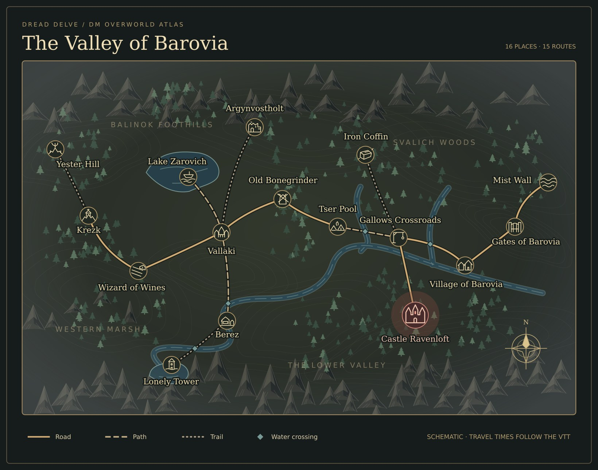
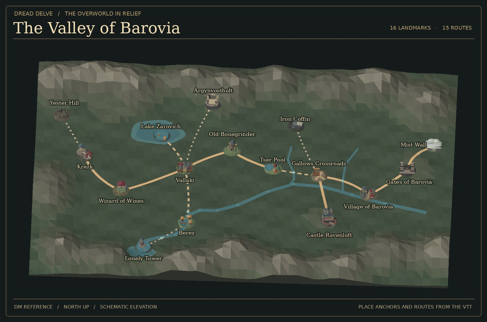

# The Valley of Barovia · Overworld atlas



The [full vector atlas](screens/barovia-overworld-atlas.svg) is the DM reference. Its locations and routes come from `VALLEY_PLACES` and `VALLEY_ROADS`. The contour lines, ranges, woods and water are schematic artwork. The route styles distinguish roads, paths and trails. A blue diamond marks a route with a water crossing.

## Layers for the Valley map

| Asset | Use |
| --- | --- |
| `public/assets/overworld/barovia-relief.svg` | Scenic backdrop with the Valley's existing `0 0 100 64` coordinate system |
| `public/assets/overworld/barovia-landmarks.svg` | Sixteen vector symbols, each named `landmark-<placeId>` |
| `docs/screens/barovia-overworld-atlas.svg` | Complete labelled DM reference with all routes and locations visible |

Put the relief beneath the existing Valley SVG's roads and markers as a full-size SVG image. Keep it behind hit targets. Use the sprite inside the existing marker groups, retaining their translated anchors, titles, labels, and click behavior. In the shared player map use the same visibility conditions as the current glyphs, including question marks for rumours and only drawing allowed routes. The relief alone contains no locations or route lines. The fully labelled reference belongs in DM-facing views.

Keep journey selection, time, encounter generation and entry into each location on the native Valley code. The atlas assets are independent of the Roads & Connections battle-scale tiles.

## Three-dimensional atlas



`public/assets/overworld/barovia-relief.glb` is a self-contained terrain board. Its X/Z bounds are `[0,100] × [0,64]`, with the northwest corner at the origin and +Z facing south. The sculpted elevations and water are schematic. The board contains geography only. Draw routes and landmarks as separate layers, using the same discovery filters as the SVG view.

For a 3D landmark, use `x = place.x` and `z = place.y`. Set its Y from a downward ray onto the relief and keep an independent hit target at the map coordinate. For route ribbons, sample the native curve, drape each point over the same surface, and lift it slightly above the board. The map retains the existing SVG as its lightweight view.

## Three-dimensional landmarks

[First six landmark renders](screens/barovia-overworld-landmarks.jpg) · [Ten additional landmark renders](screens/barovia-overworld-landmarks-expansion.jpg)

The miniatures in `public/assets/overworld/landmarks/` are named after their actual place IDs. Put them at the source coordinates when building a 3D atlas. Use Y-up, +Z south, and place the model's origin on the atlas surface. Their scale is decorative, so choose the marker scale for the zoom level. Keep the SVG markers available for low-detail views and when a GLB is unavailable.

| Place ID | Landmark |
| --- | --- |
| `castle` | Ravenloft's towers and a red window above the rock |
| `bonegrinder` | Crooked windmill with four sails |
| `vallaki` | Palisade, gatehouses, and a church spire |
| `krezk` | Hilltop abbey with a stair and cottages below |
| `tser` | Tents and a fire beside dark water |
| `coffin` | Iron wreck and scorched trees |
| `mists` | Lantern and road disappearing into the Mist Wall |
| `gates` | Iron bars between the headless guardians |
| `village` | Church on a rise and a lit tavern window |
| `crossroads` | Gallows and signpost at the fork |
| `lake` | Lake Zarovich, a skiff, and a jetty |
| `argyn` | Roofless Argynvostholt and its dark beacon |
| `berez` | Stilt houses on drowned ground |
| `winery` | The winery and rows of grapes |
| `yester` | A crooked tree in the standing-stone ring |
| `tower` | The Lonely Tower on its tarn island |

Each GLB has one mesh, one vertex-coloured material, and no external textures. These are static atlas pieces. All art is original.

## Regeneration

Run from the repository root. The SVGs regenerate from the current Valley data. The GLBs use Python 3 and the original mesh helper from Barovia prop set 01 (PR #63).

```sh
node scripts/build-barovia-atlas.mjs
python3 scripts/build-barovia-overworld-landmarks.py --builder /path/to/build-barovian-props.py
python3 scripts/build-barovia-overworld-relief.py --builder /path/to/build-barovian-props.py
```
