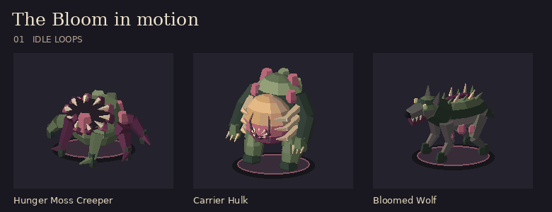

# The Bloom Bestiary


Seven original GLBs for Barovia: Flood Edition. The designs share the olive growth, purple roots, and ivory teeth of the tooth-ringed hunger moss. Each has one skinned mesh, one vertex-coloured material, and no external textures. All models face +Z and rest on Y=0. The red rings in the lineup represent tabletop bases supplied by the VTT.

| Creature | Bestiary ID | Model | Footprint |
| --- | --- | --- | --- |
| Sporeling | `sporeling` | [sporeling.glb](../public/assets/creatures/barovian-bloom/sporeling.glb) | 1 × 1 |
| Bloom Vessel | `bloom-vessel` | [bloom-vessel.glb](../public/assets/creatures/barovian-bloom/bloom-vessel.glb) | 1 × 1 |
| Carrier Hulk | `carrier-hulk` | [carrier-hulk.glb](../public/assets/creatures/barovian-bloom/carrier-hulk.glb) | 2 × 2 |
| Cyst Node | `cyst-node` | [cyst-node.glb](../public/assets/creatures/barovian-bloom/cyst-node.glb) | 1 × 1 |
| Bloom Stalker | `bloom-stalker` | [bloom-stalker.glb](../public/assets/creatures/barovian-bloom/bloom-stalker.glb) | 1 × 1 |
| Bloomed Wolf | `bloomed-wolf` | [bloomed-wolf.glb](../public/assets/creatures/barovian-bloom/bloomed-wolf.glb) | 1 × 1 |
| Hunger Moss Creeper | Custom Sporeling variant | [hunger-moss-creeper.glb](../public/assets/creatures/barovian-bloom/hunger-moss-creeper.glb) | 1 × 1 |

## Use at the table

Download a GLB, search for its creature in **Beasts**, and open **Details → Choose .glb**. The model applies to that creature's entries on the map. To keep both forms, open **Edit** on the Sporeling in Beasts, change its `name` to `Hunger Moss Creeper`, and choose **Save as new creature**. Attach the Creeper GLB to the new entry through **Details → Choose .glb**. It uses the copied Sporeling rules. The rooted tooth bloom from prop set 05 can mark its starting location.

The importer centres and sizes the models on the token bases. Legs and tails can overhang slightly. The encounter uses the footprints above for movement and targeting. The importer automatically plays the `Idle` loop on live, visible minis. The models also ship with in-place `Move` loops for the six mobile creatures.

## Motion handoff



| Creature | Idle | Move cycle |
| --- | --- | --- |
| Sporeling | Shell breath and alternating leg twitches | 0.60 s · six-leg skitter |
| Bloom Vessel | Slow sway | 1.13 s · staggered stride |
| Carrier Hulk | Expanding nursery and slow sway | 1.46 s · heavy steps |
| Cyst Node | Rooted pulse | — |
| Bloom Stalker | Twitching hooks | 0.77 s · four-point prowl |
| Bloomed Wolf | Breathing and paw twitches | 0.71 s · diagonal trot |
| Hunger Moss Creeper | A pulse and staggered root twitches | 0.88 s · rippling root crawl |

To wire travel, select `Move` by name when the mini starts stepping and crossfade back to `Idle` when it stops. Use the table's movement heading (+Z is forward) and token position. The animation never translates the model's root across the grid. A moving foot spends 62% of the cycle in contact. Match the clip rate to the token's world speed using the stance distance after model scaling. Preserve imported overrides and fall back to the existing idle for GLBs without a `Move` clip.

## Regeneration

The checked-in GLBs are self-contained. Regeneration uses Python 3 and the original mesh helper from Barovia prop set 01 (PR #63).

```sh
python3 scripts/build-barovian-bloom-creatures.py --builder /path/to/build-barovian-props.py
```
