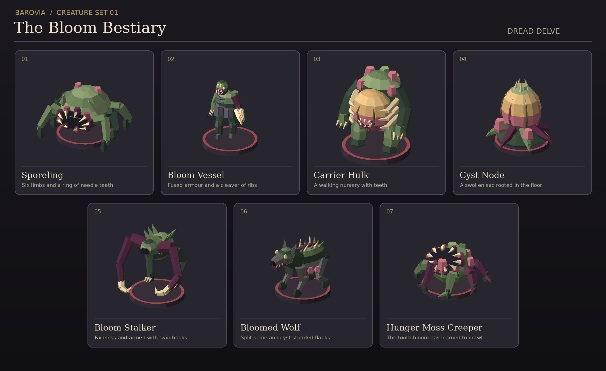

# The Bloom Bestiary



Seven original GLBs for Barovia: Flood Edition. The designs share the olive growth, purple roots, and ivory teeth of the tooth-ringed hunger moss. Each has one mesh, one vertex-coloured material, and no external textures. All models face +Z and rest on Y=0. The red rings in the lineup represent tabletop bases supplied by the VTT.

| Creature | Bestiary ID | Model | Footprint |
| --- | --- | --- | --- |
| Sporeling | `sporeling` | [sporeling.glb](../public/assets/creatures/barovian-bloom/sporeling.glb) | 1 × 1 |
| Bloom Vessel | `bloom-vessel` | [bloom-vessel.glb](../public/assets/creatures/barovian-bloom/bloom-vessel.glb) | 1 × 1 |
| Carrier Hulk | `carrier-hulk` | [carrier-hulk.glb](../public/assets/creatures/barovian-bloom/carrier-hulk.glb) | 2 × 2 |
| Cyst Node | `cyst-node` | [cyst-node.glb](../public/assets/creatures/barovian-bloom/cyst-node.glb) | 1 × 1 |
| Bloom Stalker | `bloom-stalker` | [bloom-stalker.glb](../public/assets/creatures/barovian-bloom/bloom-stalker.glb) | 1 × 1 |
| Bloomed Wolf | `bloomed-wolf` | [bloomed-wolf.glb](../public/assets/creatures/barovian-bloom/bloomed-wolf.glb) | 1 × 1 |
| Hunger Moss Creeper | Custom Sporeling variant | [hunger-moss-creeper.glb](../public/assets/creatures/barovian-bloom/hunger-moss-creeper.glb) | 1 × 1 |

## Use at the table

Download a GLB, search for its creature in **Beasts**, and open **Details → Choose .glb**. The model applies to that creature's entries on the map. To keep both forms, open **Edit** on the Sporeling in Beasts, change its `name` to `Hunger Moss Creeper`, and choose **Save as new creature**. Attach the Creeper GLB to the new entry through **Details → Choose .glb**. It uses the copied Sporeling rules. The rooted tooth bloom from prop set 05 can mark its starting location.

The importer centres and sizes the models on the token bases. Legs and tails can overhang slightly. The encounter uses the footprints above for movement and targeting. The figures have sculpted static poses and use the table's usual token movement. If bundling these later, preserve player and DM model overrides when selecting a default.

## Regeneration

The checked-in GLBs are self-contained. Regeneration uses Python 3 and the original mesh helper from Barovia prop set 01 (PR #63).

```sh
python3 scripts/build-barovian-bloom-creatures.py --builder /path/to/build-barovian-props.py
```
