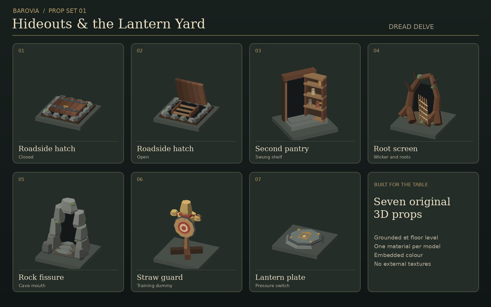

# Barovia prop set 01

Original low-poly models for the hidden refuges and the Lantern Yard. The assets
ship as self-contained glTF binary files with vertex colours. No source textures
or third-party meshes are used. Each asset has one mesh and one material.

Models are in `public/assets/props/barovian/`. The open hatch and closed hatch
are separate states with the same footprint. The shelf and root screen are
already ajar.

| File | Placement | Suggested height in grid squares |
| --- | --- | ---: |
| `road-hatch-closed.glb` | Discovered roadside hatch before opening | 0.21 |
| `road-hatch-open.glb` | Same tile after opening, ladder faces local +Z | 0.77 |
| `pantry-passage.glb` | Discovered house entrance, aperture faces local +Z | 1.30 |
| `root-screen.glb` | Discovered tree-root entrance, opening faces local +Z | 1.17 |
| `rock-fissure.glb` | Discovered cave entrance, steps face local +Z | 1.33 |
| `straw-guard.glb` | Lantern Yard dummy, bullseye faces local +Z | 1.38 |
| `lantern-plate.glb` | Walkable Lantern Gate pressure plate | 0.13 |

The models use Y-up, sit on Y=0 and fit one square using the existing footprint
scaling in `dressWithModel`. Use matching scale and rotation for both hatch
states. The tile bases in the contact sheet are display geometry.

For integration, map the new prop kinds to `barovian/<file>` in the existing
prop model catalogue and use the current on-demand loader and drawn fallback.
Use the state swap only once the hidden entrance is discovered. The map and
host keep ownership of the entrance's discovery, collision and traversal. The
dummy is a visual on the existing lobby target tile. The pressure plate should
remain walkable, with the held or lit effect supplied by the drill overlay.

Rebuild the GLBs with `python3 scripts/build-barovian-props.py`. The builder
uses the Python standard library and fixed seeds. The contact sheet is a render
of the same meshes, with lighting and a base tile for comparison.
