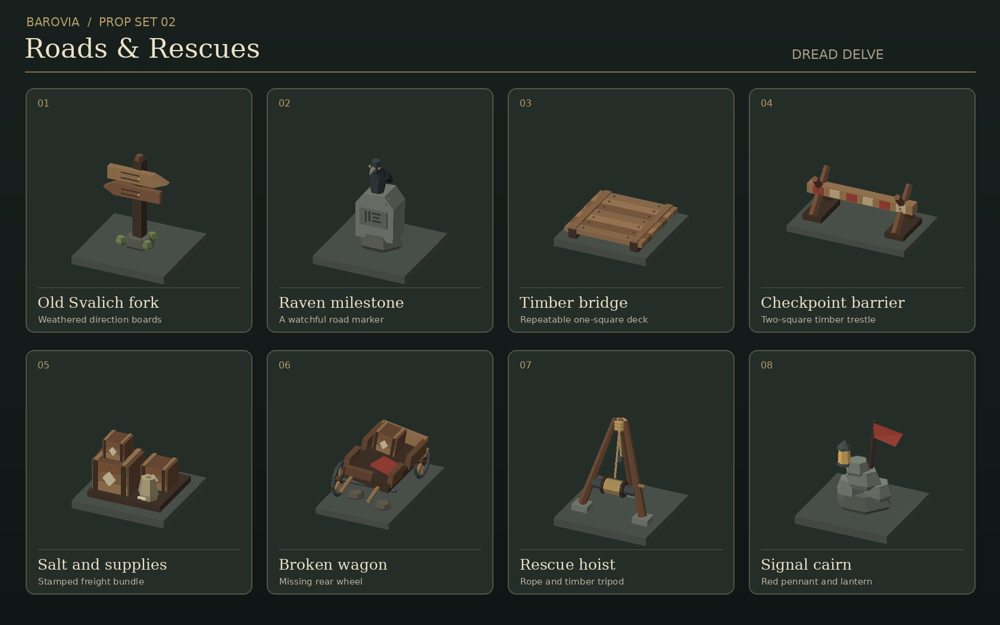

# Barovia prop set 02

Roads & Rescues is a set of eight original low-poly props for travel, checkpoints,
supply runs and roadside encounters. Each GLB has embedded vertex colours, one
mesh and one material. There are no third-party meshes or external textures.

| File | Footprint in squares | Suggested placement |
| --- | --- | --- |
| `fork-sign.glb` | 1 × 1 | At a revealed side-road marker, arrows face +Z |
| `raven-milestone.glb` | 1 × 1 | At a roadside encounter or known route, inscription faces +Z |
| `timber-deck.glb` | 1 × 1 | Repeat along local Z across a mapped bridge |
| `checkpoint-barrier.glb` | 2 × 1 | Across a road, with the painted beam facing +Z |
| `salt-cargo.glb` | 1 × 1 | On a wagon yard or next to a rescued shipment, stamp faces +Z |
| `broken-wagon.glb` | 1 × 2 | Off the travelled path, shafts point +Z |
| `rescue-hoist.glb` | 1 × 1 | Near the safe edge of a washout or ditch |
| `signal-cairn.glb` | 1 × 1 | At a roadside signal point, flag and lantern on the +Z side |

Models are in `public/assets/props/barovian-roads/`. They use Y-up and sit at
Y=0. The contact sheet's ground bases are for comparison. Use the existing
on-demand loader and fallback, and keep map collision and discovery in the
engine. The marker geometry does not imply that an undiscovered branch exists.

The deck is exactly one square wide and one square long. Its runners reach
both Z edges. Use `fit: 1` without a height cap in the prop loader so adjacent
pieces meet flush. Rotate the whole row when a bridge crosses along X. Deck art
goes only on cells the existing bridge rules already make walkable. Preserve
the two-square footprints for the barrier and wagon so their visual centre
and map footprint agree.

To regenerate, run `python3 scripts/build-barovian-road-props.py`. This reuses
the standard-library mesh and GLB helpers from prop set 01 (PR #63). Use
`--builder PATH` if that builder is in a different checkout. The shipped
GLBs are self-contained and can be loaded independently of set 01.
