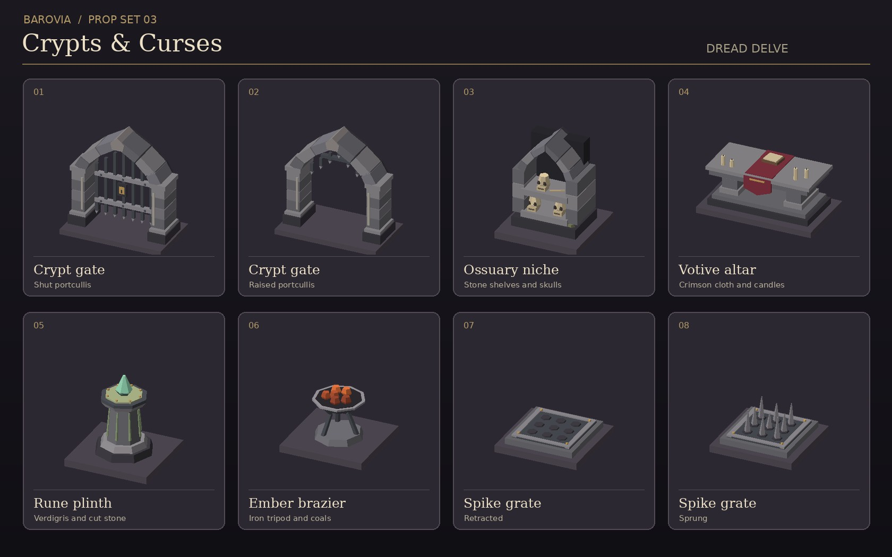

# Barovia prop set 03 · Crypts & Curses



Eight original low-poly models for crypts, sealed chapels, and hidden passages. Each GLB in `public/assets/props/barovian-crypts/` is self-contained and uses vertex colors. The preview uses display tiles that are separate from the models.

| GLB | Grid footprint | Placement |
| --- | --- | --- |
| `crypt-gate-shut.glb` | 2 × 1 | Lock or barred crypt entrance |
| `crypt-gate-raised.glb` | 2 × 1 | Open state of the same gate |
| `ossuary-niche.glb` | 1 × 1 | Wall alcove with a recessed skull shelf |
| `votive-altar.glb` | 2 × 1 | Crimson cloth, candles, and a prayer book |
| `rune-plinth.glb` | 1 × 1 | Pedestal for a ritual or puzzle interaction |
| `ember-brazier.glb` | 1 × 1 | Iron tripod and coals for an existing scene light |
| `spike-grate-retracted.glb` | 1 × 1 | Idle state of a visible or revealed floor trap |
| `spike-grate-sprung.glb` | 1 × 1 | Triggered state of the same trap |

Models are Y-up, centered on X/Z, and rest at Y=0. The gate and altar span two squares along X. Rotate a quarter turn around Y to align them along Z. Swap a gate or grate with its alternate GLB at the same transform.

Use the existing door and trap rules for movement, collision, triggering, and visibility. Reveal the grate according to the table's trap discovery state. Keep room lighting separate from the brazier mesh.

## Regeneration

The checked-in GLBs load directly. To regenerate them, use the standard-library Python mesh builder from Barovia prop set 01 (PR #63).

```sh
python3 scripts/build-barovian-crypt-props.py --builder /path/to/build-barovian-props.py
```
