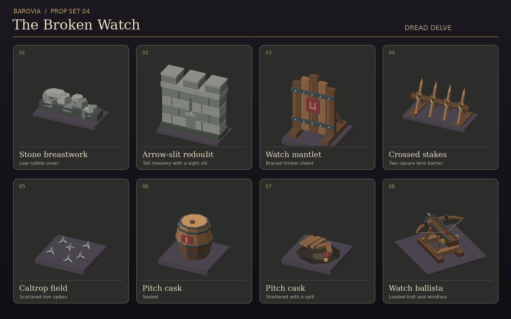

# Barovia prop set 04 · The Broken Watch



Eight original battlefield GLBs in `public/assets/props/barovian-battle/`. Each has one mesh and one material with baked vertex colours. Display tiles in the preview are separate from the props.

| GLB | Grid footprint (X × Z) | Suggested encounter use |
| --- | --- | --- |
| `stone-breastwork.glb` | 2 × 1 | Low rubble that marks a firing or rally position |
| `arrow-slit-redoubt.glb` | 2 × 1 | Tall masonry for a defended lane, with a physical slit in the mesh |
| `watch-mantlet.glb` | 1 × 1 | Braced timber screen for an archer or advancing squad |
| `crossed-stakes.glb` | 2 × 1 | Barrier across a lane or along the exposed edge of a position |
| `caltrop-field.glb` | 1 × 1 | A floor hazard that can share a square with a miniature |
| `pitch-cask-sealed.glb` | 1 × 1 | An intact cask that can be broken during a fight |
| `pitch-cask-spilled.glb` | 1 × 1 | Debris and a pitch spill after the cask breaks |
| `watch-ballista.glb` | 2 × 2 | Crewed siege weapon or defended objective, with a loaded bolt pointing along +Z |

The models are Y-up and rest on Y=0. Place the origin at the centre of the intended footprint. Rotate the two-square pieces about Y to run them along Z. The mantlet's shield faces +Z. Use the same grid anchor and unit scale for the two cask states so the spill takes over the same square.

These meshes are ready for a renderer hook. The grid and encounter rules should control cover, movement, line of sight, damage, and hazard visibility. The arrow slit is a visual opening. Keep aiming and cover tied to the encounter's sight rules. Leave a neighbouring square behind the ballista clear for its crew.

For a watchpost encounter, put the ballista behind the redoubt and make a second route around the breastwork. The stakes and caltrops can make that route costly while the mantlet gives the party a place to regroup.

## Regeneration

The checked-in GLBs are self-contained. To rebuild them, use the standard-library Python mesh helper from Barovia prop set 01 (PR #63).

```sh
python3 scripts/build-barovian-battle-props.py --builder /path/to/build-barovian-props.py
```
