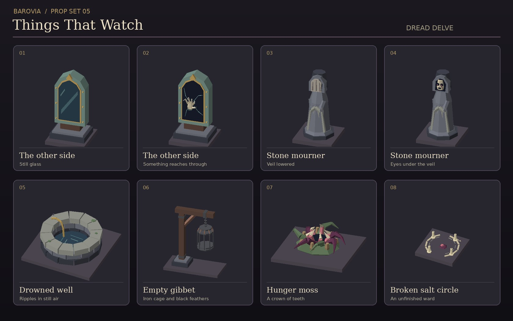

# Barovia prop set 05 · Things That Watch



Eight original low-poly GLBs in `public/assets/props/barovian-horror/`. Each is self-contained and uses one mesh with one vertex-coloured material. The display tiles in the preview are separate from the models.

| GLB | Footprint (X × Z) | Scene use |
| --- | --- | --- |
| `mirror-still.glb` | 1 × 1 | Tarnished frame and a still, painted reflection |
| `mirror-reaching.glb` | 1 × 1 | Cracked glass with a jointed hand emerging from it |
| `mourner-veiled.glb` | 1 × 1 | Hooded monument with a folded stone veil |
| `mourner-unveiled.glb` | 1 × 1 | The same monument with staring eyes beneath the hood |
| `drowned-well.glb` | 2 × 2 | Rope and ripples within a deep stone lip |
| `empty-gibbet.glb` | 2 × 1 | Suspended iron cage with black feathers inside |
| `hunger-moss-bloom.glb` | 2 × 2 | Root tendrils around a ring of teeth |
| `broken-salt-circle.glb` | 1 × 1 | Interrupted salt ward with cold candles and a purple stone |

Place each model at the centre of its footprint on Y=0. The mirror and the mourner face +Z. Use the same transform for both variants of either model. If the renderer normally centres a model by its bounds, preserve the shared base anchor for the mirror variants so the extra depth of the hand cannot shift the frame. The mirror is static and the glass is opaque. The well's ripples, cage, and candles are also static.

Keep the reaching and unveiled states on the DM side until their scene cue is revealed. A setup in a ruined chapel could start with the still mirror and the broken ward visible. The mirror's hand is the first reveal. Save the mourner's eyes for when someone looks back toward the door.

## Regeneration

The checked-in GLBs stand alone. To regenerate them, use the standard-library Python mesh helper from Barovia prop set 01 (PR #63).

```sh
python3 scripts/build-barovian-horror-props.py --builder /path/to/build-barovian-props.py
```
