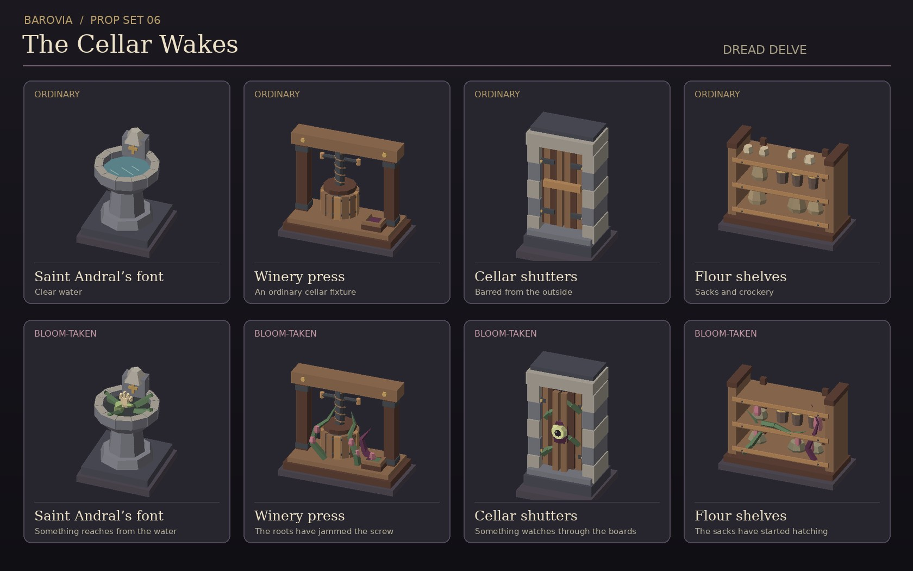

# Barovia prop set 06 · The Cellar Wakes



Eight original GLBs for Dread Delve. Each pair shares its mesh bounds, floor anchor, and grid footprint so the infested state can replace the ordinary one at the same position, rotation, and scale. Each GLB has one mesh and one vertex-coloured material. The preview's display tiles are separate.

| Furnishing | Ordinary GLB | Infested GLB | Footprint (X × Z) |
| --- | --- | --- | --- |
| Saint Andral’s font | `font-clear.glb` | `font-seep.glb` | 1 × 1 |
| Winery press | `wine-press-working.glb` | `wine-press-rootbound.glb` | 2 × 1 |
| Cellar shutters | `cellar-shutters-barred.glb` | `cellar-shutters-watching.glb` | 1 × 1 |
| Flour shelves | `flour-shelves-stocked.glb` | `flour-shelves-hatched.glb` | 2 × 1 |

All GLBs live in `public/assets/props/barovian-bloom-interiors/`. They are Y-up, rest on Y=0, and face +Z. Centre each model over the footprint. Rotate the two-square pieces about Y to place them along Z.

The models are static scene assets. Keep the revealed variant tied to the DM's scene state and the table's existing visibility rules. Use the map grid to control collision and movement. The shutters can dress a solid wall without creating a doorway.

For a gradual reveal, let the party pass the stocked shelves on their way to the font. Change the font first, then swap in the hatched shelves when they return. The shelf swap can mark the entrance of a Sporeling or Hunger Moss Creeper through the existing encounter tools.

## Regeneration

The checked-in GLBs are self-contained. To regenerate them, use Python 3 and the original mesh helper from Barovia prop set 01 (PR #63).

```sh
python3 scripts/build-barovian-bloom-interiors.py --builder /path/to/build-barovian-props.py
```
