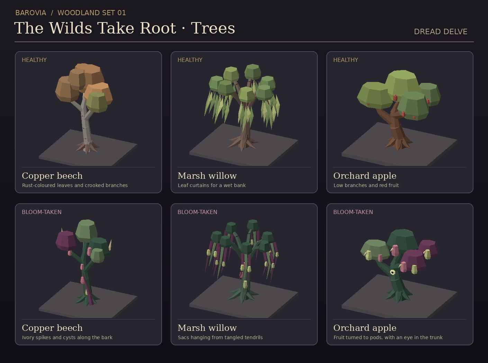
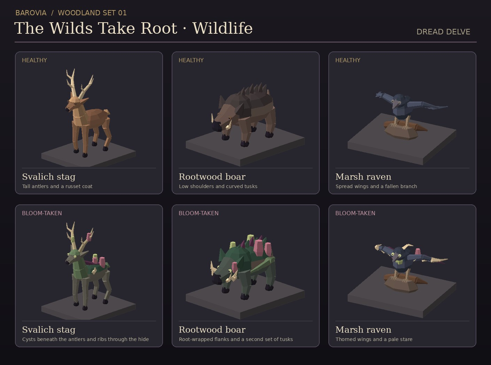

# The Wilds Take Root

Twelve original low-poly models for JackJackDnd. Each subject has a healthy and a Bloom-taken form. The GLBs have baked vertex colours and one mesh and material apiece. Display tiles in the previews are separate from the models. The raven includes its fallen branch.



| Tree | Setting | Infected form |
| --- | --- | --- |
| `copper-beech` | Svalich slopes and forest margins | Sallow canopy, ivory spikes, and cysts along the bark |
| `marsh-willow` | Tser Pool and Berez banks | Long tendrils with hanging sacs |
| `orchard-apple` | Village gardens and abandoned orchards | Fruit turned to pods, with an eye in the trunk |

The tree GLBs are in `public/assets/terrain/barovian-wilds/`. Place the source origin at the trunk's map position and keep the same position, yaw and scale across a swap. The canopy bounds vary by state. Use the trunk origin when creating the instance so a change in canopy size cannot shift the tree. Canopy and surface roots can overhang. Keep paths and collision governed by the map and use the renderer's instancing path for repeated trees.



| Animal | Existing Beasts entry | Infected form |
| --- | --- | --- |
| `svalich-stag` | Deer (`srd-deer`) | Cysts beneath the antlers and ivory growths through the hide |
| `rootwood-boar` | Boar (`srd-boar`) | Root-wrapped flanks and a second set of tusks |
| `marsh-raven` | Raven (`srd-raven`) | Thorned wings and pale eyes |

The wildlife GLBs are in `public/assets/creatures/barovian-wilds/`. All face +Z and stand on Y=0. Use **Beasts → Details → Choose .glb** to load a model. To keep both forms available as separate minis, use **Edit**, give the duplicate a distinct `name`, and select **Save as new creature**. Attach the second GLB to that new entry. These models have static poses and leave movement, targeting, and the creatures' rules to the table.

Each family has `-healthy.glb` and `-bloomed.glb` variants. The woodland scene can start with healthy fixtures and animals. When the Bloom reaches the grove, swap a few tree models first and reveal the infected animals as encounters.

## Regeneration

The checked-in GLBs are self-contained. To regenerate them, use Python 3 and the original mesh helper from Barovia prop set 01 (PR #63).

```sh
python3 scripts/build-barovian-wilds.py --builder /path/to/build-barovian-props.py
```
