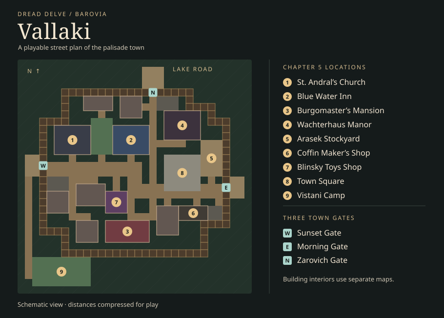

# Exploring the settlements of Barovia

The most playable settlement in the existing VTT is Hollin’s Ford. Its buildings
give players reasons to cross the village and talk to specific people. Vallaki
needs that same level of authorship, starting with the geography from
[*Curse of Strahd*, Chapter 5](https://www.dndbeyond.com/sources/dnd/cos/the-town-of-vallaki)
and [Mike Schley’s town map](https://www.behance.net/gallery/40349071/The-Town-of-Vallaki).

| Place | What the party can explore today | What would bring it to life |
| --- | --- | --- |
| **Vallaki** | Previously a seeded main street and square. This pass gives it a fixed palisade, three gates, named streetside destinations and a southwest camp trail. The six named buildings use the Maps shelf’s existing **Go inside** action. | Start with the Blue Water Inn, St. Andral’s and the Coffin Maker’s Shop as separate authored interiors. Give each a public area, a reason for a second visit and a route to its private rooms. Connect the other chapter sites and staff each gate. |
| **Village of Barovia** | Seeded square, houses, church and playable undercroft. The tavern, mercantile and housing are fitted around the street. The Narrow House is placed after filler and appeared in **0 of 100** sampled layouts. | Reserve the Narrow House lot before filler. Anchor Ireena and Ismark at the burgomaster’s house, the priest at the church, and a dependable public meeting place on the road. Let shutters, deliveries and vigils tell the party what changed on a return visit. |
| **Krezk** | Stone-walled village with a chapel, a pool reference and a road heading uphill. Its template has one playable floor. | Make the gate, sheltered household yards, pool and abbey distinct stops. Give the wine delivery a visible consequence at the gate, and let players walk uphill to a separate Abbey of Saint Markovia map. |
| **Berez** | Flooded causeways, islands and stilt huts. The walking hut was present in **97 of 100** sampled layouts. | Reserve the walking hut and a reliable central ruin first. Let water levels shift optional routes, and use high-water marks and a reachable lookout to give players clues before committing to a crossing. |
| **Tser Pool** | Painted wagons around a fire, the reader’s tent and the pool. This is a separate map from Vallaki’s southwest camp. | Run the camp as an arrival scene with a host, a public fire, private conversations at the wagons and a clear invitation into the reader’s tent. Give the Vallaki camp its own people and business. |
| **Wizard of Wines** | Vineyards, press house, storehouse, family house and a cellar floor. | Show the supply chain in the space. A missing worker or blocked cart route affects the press yard, and successful deliveries bring recognizable goods back to town. |
| **Lake Zarovich and the Lonely Tower** | Shore, jetty and fishing structures at the lake. The tower has its own island, upper room and roof. | Let shore activity change with time and weather. Use a predictable arrival route and an observable sign of occupancy at the tower so players can approach it deliberately. |
| **Hollin’s Ford** | The Session 0 maps already give the Lantern & Ladle a common room, kitchen, snug and stable yard. The market, Brask Cottage, chapel, smithy and provisions shop all feed the missing-salt story. | Keep this as the template for new hamlets. Make the inn facade lead to the already-authored tavern floor, and let the stock, regulars and conversation reflect how the players handled the missing cargo. |
| **Roadside hovels and player holdings** | Hut and cottage interiors can be generated. The separate holdings system supports a camp, house, homestead, outpost, fort and keep. | Author three small encounter layouts using the existing interiors and refuge systems. Give a lived-in hovel a person at work, an abandoned hovel evidence the party can follow, and a hidden refuge a concealment route and a reason someone might risk finding it. |

The two generator samples use integer seeds 0 through 99 with `genPlace`. They
measure whether the named building was placed in the layout.

## Vallaki in play

The authored exterior follows the chapter’s relative geography on a compressed
VTT grid. The Old Svalich Road connects the west **Sunset Gate** to the east
**Morning Gate**. The north **Zarovich Gate** faces the lake road. A path from the
west approach leads around the wall to camp. The church is on the western street,
the Blue Water Inn and Wachterhaus are north of the main route, the mansion is
south, Blinsky’s is central, and the square, stockyard and coffin shop are to the east.

The gates start closed and use normal VTT door controls. The DM can lock them;
automatic night locking and guard checks are later work. The small gate lodges
are traversable rooms that give the existing roaming folk system places to start.
Vallaki’s Story/Valley entries continue to use the same template ID. Existing
saved maps are loaded from the Maps shelf, so use a fresh Vallaki map to preview
this layout. The separate Saint Andral campaign map remains available from the Valley.

## Handoff for Claude

1. **Give each gate a job.** Start with the existing Valley clock and folk
   schedules. At dawn, put the watch at the entrances. As night falls, have
   the watch lock the gate only when its shift is present. Put a clear guard
   interaction on each approach and give the party a way to request entry.
2. **Tie named people to the doors.** Place Father Lucian at the church, the
   Martikovs at the inn and Blinsky at his shop during their working hours.
   Anchor their whereabouts to building IDs. Public conversations and room
   discoveries can go to phones through the existing cards and map reveal.
3. **Run scenes from the chapter in response to the table.** Keep festivals
   and the church investigation under DM control. Hang public notices in
   the square and save changes to individual places as the party intervenes.
   Keep private leads on the DM side until a player discovers them.
4. **Build the book interiors one at a time.** Use original geometry and
   descriptions in repo-authored maps, and keep text and art from the
   licensed source in the DM’s private material. The named Vallaki facades
   currently use the existing procedural interiors. The church’s street
   door uses the ordinary church interior, while the separate Saint Andral
   map is still the campaign’s Bloom content.
